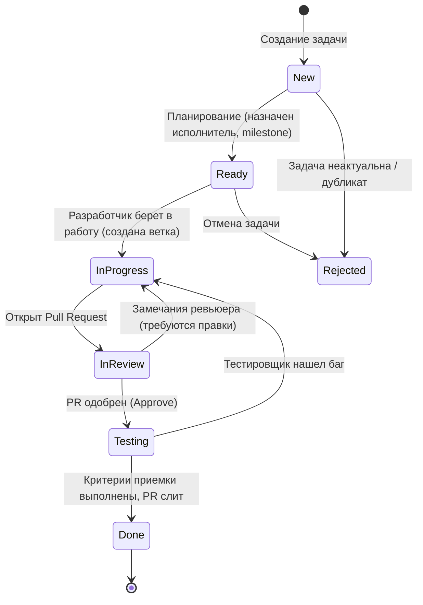

# ЛР 5. Управление задачами, workflow проекта и интеграция с СКВ

Документ регламентирует правила ведения задач, процесс разработки (workflow), структуру бэклога и интеграцию задач с системой контроля версий Git в проекте «Тыкуэн».

---

## 1. Выбор системы управления проектами

В соответствии с решением команды (см. `docs/DECISIONS.md`, решение № 2) и методическими указаниями («Redmine или аналог: Jira, Trello»), в качестве основной системы управления задачами используется **GitHub Projects (доска Kanban) + GitHub Issues**, а также предусмотрена полная схема развертывания и конфигурации в **Redmine** для академической отчетности.

Преимущества GitHub Projects + Issues для проекта «Тыкуэн»:

1. **Нативная интеграция с Git-репозиторием** (`https://github.com/gutov1/tykuen`). Не требуется настройка сторонних вебхуков и внешних серверов.
2. **Автоматическая смена статусов**: при создании PR статус задачи меняется на `In Review`, а при слиянии PR со словом `Closes #ID` задача автоматически переходит в `Done`.
3. **Единое окно для команды**: код, коммиты, ревью, обсуждения и доска задач находятся в одном интерфейсе.

---

## 2. Трекеры (типы задач)

В проекте утверждены 4 трекера задач:

| Трекер (Redmine / GitHub)              | Назначение                                                                 | Пример                                                   |
| -------------------------------------- | -------------------------------------------------------------------------- | -------------------------------------------------------- |
| **Задача / Feature (`type: feature`)** | Реализация новой пользовательской или продуктовой функциональности.        | Экран создания объявления с загрузкой 5 фото             |
| **Ошибка / Bug (`type: bug`)**         | Исправление сбоя, некорректного поведения или дефекта.                     | Сообщения в чате не скроллятся вниз при получении нового |
| **Дополнение / Chore (`type: chore`)** | Технические задачи: настройка CI/CD, рефакторинг, обновление зависимостей. | Добавление шага линтинга в GitHub Actions                |
| **Документация / Docs (`type: docs`)** | Разработка и обновление проектной документации, регламентов и отчетов.     | Оформление отчета по ЛР 5                                |

---

## 3. Workflow проекта (жизненный цикл задачи)

### Статусы задач:

1. **Новая (New / Backlog)**: задача зафиксирована в бэклоге, описана, но работа по ней еще не начата.
2. **К выполнению (Ready / To Do)**: задача прошла приоритизацию на стендапе, декомпозирована, назначена на этап (Milestone) и готова к взятию разработчиком.
3. **В работе (In Progress)**: исполнитель создал ветку (`feature/<id>-...` или `bugfix/<id>-...`) и ведет разработку.
4. **На ревью (In Review / Code Review)**: разработка завершена, открыт Pull Request в ветку `develop`, назначен ревьюер.
5. **Тестирование (Testing / QA)**: изменения прошли code review, развернуты в тестовом окружении / проверены тестировщиком по критериям приемки.
6. **Выполнена (Done / Closed)**: PR успешно влит (Squash and merge) в `develop`, автотесты прошли, критерии приемки выполнены.
7. **Отклонена (Rejected / Won't Do)**: задача признана неактуальной, дублирующей или отложена.

### Матрица переходов (Workflow Transitions):



---

## 4. Регламент и правила описания задач

Каждая задача в проекте должна содержать строго определенный набор обязательных полей:

1. **Тема (Subject / Title)**:
   - Формат: `[ТРЕКЕР] Краткое описание действия` (на русском языке, глагол в инфинитиве или повелительном наклонении).
   - Пример: `[FEAT] Реализовать компонент фильтрации по населенным пунктам КБР`.
2. **Описание (Description)**:
   - **Пользовательская история (User Story)**: `Как [пользователь], я хочу [...], чтобы [...]`.
   - **Критерии приемки (Definition of Done)**: чеклист пунктов, без выполнения которых задача не принимается.
   - **Технический контекст**: затронутые файлы, таблицы БД, сторонние API.
3. **Трекер (Tracker / Type)**: `Feature`, `Bug`, `Chore`, `Docs`.
4. **Статус (Status)**: текущее состояние жизненного цикла.
5. **Приоритет (Priority)**:
   - `Низкий (Low)` — фоновые улучшения, не влияющие на MVP.
   - `Средний (Normal)` — стандартная функциональность по плану.
   - `Высокий (High)` — ключевой функционал текущего этапа.
   - `Критический / Блокирующий (Urgent / Blocker)` — падение сборки, блокировка работы команды, утечка данных.
6. **Исполнитель (Assignee)**: конкретный член команды, несущий ответственность за задачу.
7. **Оценка времени (Estimated Time)**: трудоемкость в часах (например, `4h`, `8h`).
8. **Версия / Этап (Target version / Milestone)**: этап проекта (`ЛР 4`, `ЛР 5`, `ЛР 6: MVP`, `ЛР 7: CI/CD`).
9. **Теги / Метки (Labels / Tags)**:
   - Компонент: `frontend`, `backend`, `database`, `ui`, `pwa`.
   - Модуль: `auth`, `listings`, `chat`, `profile`, `favorites`.

---

## 5. Связь между коммитами в Git и задачами

### Правило именования веток:

- `feature/<номер_задачи>-<краткое-описание>`
- `bugfix/<номер_задачи>-<краткое-описание>`
- Пример: `feature/10-task-workflow`

### Формат коммитов (Conventional Commits + Issue ID):

```
<type>(<scope>): <краткое описание> #<номер_задачи>
```

Примеры:

```bash
feat(workflow): настроить статусы и трекеры задач проекта #10
fix(auth): исправить обработку ошибки при неверном пароле #6
docs(workflow): описать правила совместной работы в Redmine и СКВ #10
```

### Автоматическое связывание и закрытие через Pull Request:

В теле Pull Request указывается директива закрытия:

```markdown
Closes #10
```

При слиянии Pull Request система (GitHub или Redmine с плагином GitHub Webhooks):

1. Добавляет ссылку на коммит и PR в историю задачи.
2. Автоматически переводит задачу в статус `Done` (`Closed`).
3. Фиксирует дату завершения и затраченное время.

---

## 6. Реестр бэклога задач проекта «Тыкуэн»

| ID  | Трекер  | Тема задачи                                                       | Приоритет  | Оценка | Исполнитель | Этап | Метки                   |
| --- | ------- | ----------------------------------------------------------------- | ---------- | ------ | ----------- | ---- | ----------------------- |
| #1  | Chore   | Каркас проекта React + Vite + TypeScript и правила команды        | Высокий    | 6 ч    | Тимлид      | ЛР 3 | `core`, `setup`         |
| #2  | Docs    | Разработка CONTRIBUTING.md и шаблонов PR                          | Нормальный | 4 ч    | Аналитик    | ЛР 3 | `docs`                  |
| #3  | Docs    | Оформление отчета по лабораторной работе №3                       | Нормальный | 4 ч    | Тестировщик | ЛР 3 | `docs`                  |
| #4  | Feature | Подключение Supabase: клиент, переменные окружения, .env          | Высокий    | 4 ч    | Разработчик | ЛР 4 | `backend`, `db`         |
| #5  | Feature | Схема базы данных: profiles, settlements, categories и RLS        | Высокий    | 8 ч    | Разработчик | ЛР 4 | `backend`, `db`         |
| #6  | Feature | Регистрация и вход по email и паролю                              | Высокий    | 6 ч    | Тимлид      | ЛР 4 | `frontend`, `auth`      |
| #7  | Feature | Восстановление пароля («Забыли пароль?»)                          | Нормальный | 4 ч    | Тимлид      | ЛР 4 | `frontend`, `auth`      |
| #8  | Feature | Дизайн-система: цвета, кнопки, инпуты, карточки                   | Высокий    | 8 ч    | Дизайнер    | ЛР 4 | `frontend`, `ui`        |
| #9  | Feature | Роутинг, шапка приложения и адаптивный layout                     | Нормальный | 6 ч    | Дизайнер    | ЛР 4 | `frontend`, `ui`        |
| #10 | Feature | Настройка доски задач, workflow и интеграция с Git                | Высокий    | 6 ч    | Тимлид      | ЛР 5 | `workflow`, `pm`        |
| #11 | Feature | Создание объявления: форма, выбор сделки, категория               | Высокий    | 8 ч    | Разработчик | ЛР 6 | `frontend`, `listings`  |
| #12 | Feature | Загрузка и хранение фото объявлений (до 5 шт.) в Supabase Storage | Высокий    | 6 ч    | Разработчик | ЛР 6 | `backend`, `storage`    |
| #13 | Feature | Лента свежих объявлений с фильтром по населенным пунктам          | Высокий    | 6 ч    | Тимлид      | ЛР 6 | `frontend`, `listings`  |
| #14 | Feature | Полнотекстовый поиск по объявлениям и фильтрация по категории     | Нормальный | 6 ч    | Разработчик | ЛР 6 | `frontend`, `listings`  |
| #15 | Feature | Детальная страница объявления с контактами продавца               | Высокий    | 6 ч    | Дизайнер    | ЛР 6 | `frontend`, `listings`  |
| #16 | Feature | Модуль «Избранное»: сохранение и удаление объявлений              | Нормальный | 4 ч    | Тестировщик | ЛР 6 | `frontend`, `favorites` |
| #17 | Feature | Текстовый чат в реальном времени (Supabase Realtime)              | Высокий    | 10 ч   | Разработчик | ЛР 6 | `backend`, `chat`       |
| #18 | Feature | Профиль пользователя: мои объявления, редактирование              | Нормальный | 6 ч    | Дизайнер    | ЛР 6 | `frontend`, `profile`   |
| #19 | Feature | Лимиты публикаций (1 объявление в сутки) на уровне БД             | Высокий    | 4 ч    | Разработчик | ЛР 6 | `backend`, `security`   |
| #20 | Feature | Настройка PWA: манифест, Service Worker, офлайн-заглушка          | Нормальный | 6 ч    | Тимлид      | ЛР 6 | `frontend`, `pwa`       |
| #21 | Chore   | Настройка CI/CD пайплайна в GitHub Actions                        | Высокий    | 6 ч    | Разработчик | ЛР 7 | `ci`, `devops`          |
| #22 | Chore   | Контейнеризация проекта в Docker и Docker Compose                 | Нормальный | 6 ч    | Тимлид      | ЛР 7 | `devops`, `docker`      |
| #23 | Docs    | Подготовка итоговой презентации и материалов к защите             | Высокий    | 8 ч    | Команда     | ЛР 8 | `docs`, `final`         |
| #24 | Bug     | Исправление автоматического скролла сообщений в чате              | Нормальный | 2 ч    | Разработчик | ЛР 6 | `bug`, `chat`           |
| #25 | Bug     | Ошибка валидации формата email при регистрации                    | Нормальный | 2 ч    | Тимлид      | ЛР 4 | `bug`, `auth`           |
