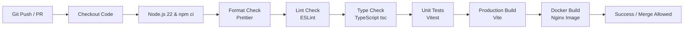

# ЛР 7. Вспомогательные инструменты разработки: CI/CD, Linters, Тестирование, Docker

Документ описывает вспомогательные инженерные инструменты, обоснование их выбора, процесс настройки и регламент использования в проекте «Тыкуэн».

---

## 1. Исследование и обоснование вспомогательных инструментов

| Инструмент                       | Технология в проекте                        | Назначение                                                         | Обоснование выбора                                                                                                                                                         |
| -------------------------------- | ------------------------------------------- | ------------------------------------------------------------------ | -------------------------------------------------------------------------------------------------------------------------------------------------------------------------- |
| **CI/CD**                        | **GitHub Actions**                          | Автоматическая проверка кода при каждом push и Pull Request        | Нативная интеграция с GitHub-репозиторием команды, отсутствие необходимости разворачивать свой сервер (Jenkins), 2000 бесплатных минут в месяц, поддержка кэширования npm. |
| **Статический анализ (Linters)** | **ESLint 9 + TypeScript-ESLint + Prettier** | Проверка стиля кода, обнаружение потенциальных багов и уязвимостей | Строгая типизация TypeScript (`strict`), единый стиль оформления без холиваров на ревью, автоматическое форматирование при сохранении.                                     |
| **Автоматическое тестирование**  | **Vitest + React Testing Library**          | Unit- и интеграционные тесты интерфейса и логики                   | Мгновенный запуск благодаря ESM и интеграции с Vite (быстрее Jest в 4–10 раз), встроенная изоляция окружения `jsdom`, синтаксическая совместимость с Jest.                 |
| **Контейнеризация**              | **Docker + Docker Compose + Nginx Alpine**  | Изоляция окружения, детерминированная сборка и раздача статики     | Исключение проблемы «у меня на компьютере работает, а на сервере нет», минимальный размер продакшн-образа (< 35 МБ), настроенная маршрутизация SPA и кэширование PWA.      |

---

## 2. Структура пайплайна непрерывной интеграции (CI Pipeline)

Пайплайн настроен в `.github/workflows/ci.yml` и запускается на событиях `push` и `pull_request` в ветки `main` и `develop`.



### Этапы валидации:

1. `npm run format:check` — проверяет форматирование по `.prettierrc.json`.
2. `npm run lint` — проверяет правила ESLint (`eslint.config.js`).
3. `npm run typecheck` — выполняет строгую проверку типов TypeScript без генерации кода (`tsc -b`).
4. `npm test` — запускает набор unit- и компонентных тестов Vitest.
5. `npm run build` — компилирует оптимизированную production-сборку в каталог `dist/`.
6. `docker build` — собирает Docker-образ с веб-сервером Nginx.

---

## 3. Контейнеризация проекта в Docker

Для проекта реализована двухэтапная сборка (Multi-stage build) в `Dockerfile`:

1. **Stage 1: Сборка (builder)** — базовый образ `node:22-alpine`. Устанавливаются зависимости через `npm ci` и запускается `npm run build`.
2. **Stage 2: Раздача (runner)** — легковесный образ `nginx:alpine`. В него копируются только скомпилированные файлы из `/app/dist` и кастомный конфиг `nginx.conf`.

### Команды для запуска контейнера:

```bash
# Сборка и запуск через Docker Compose
docker compose up -d --build

# Проверка статуса контейнера
docker ps

# Остановка контейнера
docker compose down
```

Приложение доступно по адресу: `http://localhost:8080`.
